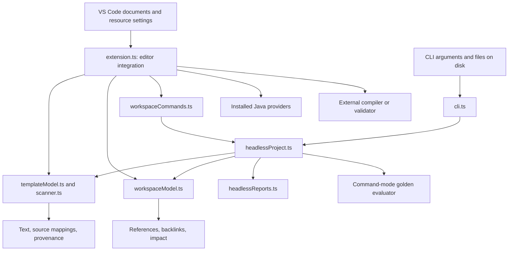

# JetForge architecture

JetForge separates local template analysis from editor interaction and project execution. The shared core handles strings, ranges, paths, workspace dependencies, and project reports. VS Code adapters provide documents, UI, commands, diagnostics, and access to installed language tooling. The CLI loads the same project core from files on disk.

For authoring behavior, see [Template language](TEMPLATE_LANGUAGE.md). For project execution and reports, see [Headless projects](HEADLESS.md). For implementation entry points and tests, see [Development guide](DEVELOPMENT.md).

## Components and boundaries

The static website (`index.html`, `feature-roadmap.html`, `styles.css`, `script.js`) is a separate presentation surface. It is excluded from the extension package and is not part of runtime template analysis.

## Template model

`templateModel.ts` recognizes outer text, directives, scriptlets, expressions, and declarations. Each block stores its delimiter-inclusive range and content range; parsed directives also retain attribute ranges. These offsets let features refer back to the original source rather than reconstructing locations from formatted text.

`scanner.ts` supplies syntax and directive diagnostics. It checks template structure and local references; it does not perform full Java type checking. `regionClassifier.ts` uses the block model to distinguish output regions from delimiters and embedded Java. `detector.ts` selects the outer target from filename hints and content.

The same parsed model feeds two projections:

- **Output projection:** copy outer text, expand readable includes, and substitute language-aware placeholders for template Java and directives. Include boundaries remain visible in the preview.
- **Java projection:** place declarations at class scope; create a `generate()` method with a `StringBuilder`; convert outer text to append statements, expressions to Java append expressions, and scriptlets to method content. A supported skeleton can supply the surrounding class layout.

Neither projection invokes a Java runtime. Real output enters through the [builtin v2 pipeline](BUILTIN_COMPILER.md) or a configured external tool. `txtjetCompiler.ts` emits Java and mappings; `builtinCompiler.ts` snapshots inputs and runs the packaged JVM bridge; `builtinProject.ts` resolves targets; `builtinEditor.ts` supplies trust, cancellation, live buffers and read-only results. This core is shared by editor and CLI.

## Ranges and provenance

Every projection returns a `TxtJetGeneratedPreview` containing `text`, `mappings`, and `provenance`.

| Structure | Purpose |
| --- | --- |
| `TxtJetMapping` | Relates a source range to a preview range and records the block/projection kind. |
| `TxtJetProvenance` | Adds the contributing filename, origin kind, confidence, and optional label to a preview span. |
| Line provenance | Groups contributing spans for preview markers and source inspection. |

Source ranges use JavaScript string offsets and an exclusive `end`. VS Code positions are calculated at the adapter boundary. One preview line can contain multiple origins, so a line marker is a navigation aid rather than a claim that every character came from one source.

`provenance.ts` builds line-level origins. The editor displays `R` for root text, `I` for includes, `E` for expressions, `S` for skeleton content, and `?` for unmapped content. `previewSync.ts` and mapping helpers support source/preview reveal only where ranges can be related. Expression placeholders carry approximate provenance; they do not establish the source of an evaluated expression's eventual output.

External output can acquire provenance from uniquely matching preview lines. Repeated, transformed, evaluated, or compiler-only lines can remain unmapped. An unmapped result is preferable to navigating or attaching a diagnostic to an unrelated source range.

## Workspace model and dependencies

`workspaceModel.ts` builds a file-based index of root templates, `.jetinc` fragments, and `.skeleton` files. Include and skeleton edges retain their source directive and resolved target. Reverse references support finding including templates and identifying affected roots.

The Explorer tree presents applicable groups, unresolved references, and generated targets. `impactGraphView.ts` renders a local interactive dependency graph. `javaWorkspaceIntelligence.ts` adds a deterministic index of workspace `@jet` classes and accessible methods from declaration blocks; it can resolve common receiver and call patterns without a full Java semantic model.

Resolution first considers the referencing file's directory, then configured search roots. Path canonicalization in `extensionSupport.ts` includes existing symlink ancestors. Editor adapters enforce workspace/configured-root containment and apply Restricted Mode limits; the headless contract keeps project paths under its root.

Editor indexing is bounded by file count, per-file size, aggregate bytes, and elapsed time. When a budget is reached, the editor retains a partial model and reports the limit in its output channel. The CLI uses a separate discovery path and file-count bound; a complete CLI scan does not prove the editor indexed the same full project.

## Editor document lifecycle

The editor registers read-only virtual documents for generated output and generated Java. Their URI schemes are `txtjet-preview-output` and `txtjet-preview-java`. A stable URI allows existing preview tabs to refresh instead of creating a tab for each edit.

Preview reads prefer open include/skeleton buffers to disk. Source edits, dependency edits, file creation/deletion, and topology changes trigger refreshes of affected roots. `asyncRefresh.ts` coalesces event bursts; `previewCache.ts` caches mapping work by source, document version, and variant with a bounded entry count.

Project commands from `workspaceCommands.ts` use the disk-based headless loader. This is a deliberate operational distinction: save changes before expecting Doctor, full-workspace generation, or golden cases to validate those changes. The ordinary editor preview can already show unsaved content.

## Java assistance

`javaIntelliSenseBridge.ts` maps a Java position in a template into the generated Java projection. The editor can then ask installed Java providers for completion, hover, or definition. Results are useful only when the provider accepts the virtual document and the result maps back to the source.

Local fallbacks provide common suggestions, declaration/helper navigation, narrow helper references/rename, and signature help. `javaSyntax.ts` masks comments and strings when locating calls. Cross-template methods come from the workspace class index. External `.java` dependencies and complex Java semantics remain the responsibility of installed tooling.

Target-language fallbacks for Java, Python, and C/C++ assist the generated-text region. They are separate from Java inside template blocks and do not replace a target-language server.

## External processes and validation

Editor compiler commands pass through `externalCommand.ts`: parse an executable and argument list, substitute path placeholders as data, and call `execFile`. Workspace Trust gates execution. A wrapper script is the integration point for tools needing shell operations.

`validationRuns.ts` gives each source a generation token, document version, and abort signal. A newer run cancels the preceding run; results are accepted only when the token still matches the open document. Temporary output naming in `generationPaths.ts` prevents overlapping validations from sharing their output input. `compilerDiagnostics.ts` parses tool problems and maps known generated locations conservatively.

Command-mode golden cases follow a different path in `headlessProject.ts`: shell-quote supported placeholders, execute the configured command through Node's `exec`, then read the declared output file. The command is trusted project code. [HEADLESS.md](HEADLESS.md#command-mode-evaluation) describes its inputs and error behavior.

## Refactors and output persistence

Refactor commands assemble a plan before applying edits. `refactorPlans.ts` handles conservative Java class/helper/import recipes; workspace reference operations use the current dependency model. The editor shows the proposed changes and aborts when a required reference range cannot be proven.

`generationPaths.ts` preserves the workspace-relative source directory and original filename before appending the target extension. This avoids collisions between equal stems in different directories or different template suffixes. Explicit generation writes persistent output; preview documents remain virtual. Golden baselines are separately managed expected files and change only through an explicit baseline update workflow.

The extension stores bounded local previous-generation snapshots for diffs. Snapshots are conveniences for inspection, while checked-in golden files are the reproducible project contract.
